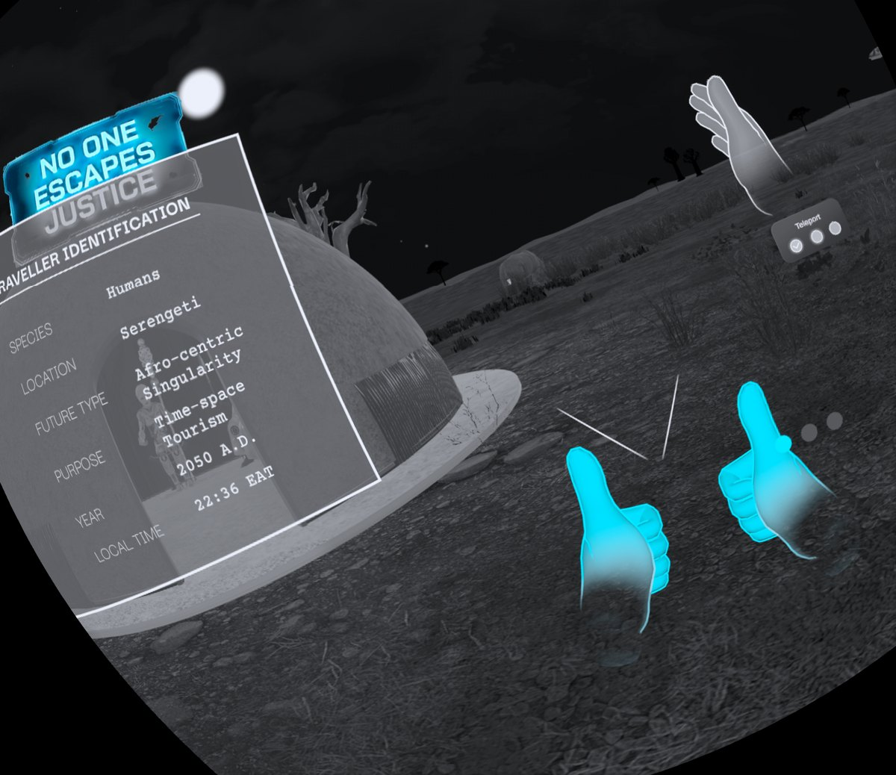

# Baraza VR - Release Notes

All notable changes to Baraza VR are documented here. Newest release first.
Baraza VR is an Afro-futuristic VR courtroom drama for Meta Quest 3.

## [0.2.2] - 2026-09-14
The self-resetting exhibition build: the court starts over by itself, animals roam the plain, and visitors arrive facing the dome.

### Added
- The experience resets itself, so the next visitor always starts from the beginning. The rules:
  - Headset off for less than 20 seconds, then back on: the story continues where it was.
  - Headset off for 20 seconds to 3 minutes: the next person to put it on is asked to continue or start over. With no answer it starts over after 30 seconds.
  - Headset off for 3 minutes or more: it starts over silently.
  - Worn but motionless for 3 minutes: a card asks if anyone is still there. With no answer it starts over after 60 seconds.
  - Staff restart at any time: hold both thumbs up for about two seconds. The hands turn blue and three dots fill above the right hand while you hold. A card asks to confirm. With nothing pressed, the card goes away after 20 seconds. On controllers, press Start on the left controller for the same card.
- A short notice on the landing card says when the experience has just started over.
- Animals on the plain outside the dome: an elephant with her calf, a rhino, a buffalo, a hyena, a giraffe and two butterflies. They wander, feed and rest, and keep clear of the path, the dome entrance and the trees.
- After the verdict, a small button above the results panel shrinks it out of the way so you can look around the court. Press it again to bring the panel back.

### Fixed
- You now arrive facing the dome, with the landing card in front of you, whichever way you were facing when you put the headset on.
- Taking the headset off mid-story no longer leaves the experience where the last visitor stopped. See the reset rules above.
- The sign above the dome and the fireflies no longer show through the black screen while the world loads at the start.
- Teleporting can no longer pass through the dome wall. The doorway is the way in and out.

### Known Issues
- The picture may stutter for a few seconds while the court is transcribing your answer.
- Kiswahili is not yet available.
- Voice recognition can mishear some words with certain accents. Speak clearly, review what the court heard, and speak again if needed.

## [0.2.1] - 2026-09-03
The exhibition build: hand-tracked movement, the Council's dossiers, and a fairer Judge.

### Added
- Hand-tracked teleport. Pinch to teleport across the plain, through the dome entrance and anywhere inside. Controllers still work.
- A short animated coach shows the teleport gesture on arrival, then disappears.
- Councilor seals. Each councilor has a seal beside them. It glows when you look at it or point at it.
- Councilor dossiers. Pinch a seal to open that councilor's card: who they are and what they stand for. A Dossier button opens their full story. Pinch the seal again to close. One card open at a time.
- Sound on opening and closing the cards and the dossier.
- Ink illustrations on the chronology screen.
- Ambient night sound at the entrance: wind in the grass, crickets, occasional night birds.
- Trial timer cues: a tick in the final seconds of each answer and a warning tone when time is low.
- A version number in the bottom-right corner of the landing card.

### Changed
- The chronology and incident report screens scroll in step with the narration. Manual scrolling returns when the narration ends.
- With controllers, only one ray is shown while aiming a teleport.
- The standing marker inside the dome is now in front of the question panel, not under it.
- The seals no longer rotate. They brighten on hover and scale up while their card is open.

### Fixed
- Scoring: honest answers in plain words were being marked as evasive, so most trials ended guilty. Corrected. Denial phrased around keywords and repeated filler still earn no credit. On a fifty-trial rehearsal scored by hand, the court now agrees with the verdict in forty-five cases.
- Teleporting through the dome entrance and to every part of the interior.
- Dome walls are solid.
- Letter spacing on the incident report.

### Known Issues
- You may arrive facing away from the dome. Turn around.
- Removing the headset mid-story does not reset the experience for the next visitor.
- Kiswahili is not yet available.
- Voice recognition can mishear some words with certain accents. Speak clearly, review what the court heard, and speak again if needed.

## [0.2.0] - 2026-08-18
The court now listens. Speak your answers aloud and the Judge weighs your own words to reach the verdict.

### Added
- Voice on trial: answer all five of the court's questions by speaking, review what the court heard, then confirm or speak again.
- The verdict is computed from your spoken answers, and the results meter now points at your actual score.
- A glowing marker inside the dome shows where to stand, appearing once the incident reading ends, with its own guiding beacon tone.
- Courtroom sound design: the verdict gavel, microphone start and stop cues, a chime when it is your turn to speak, and a threshold sound at the dome door.
- A balanced audio mix that softens the ambience whenever the court speaks.

### Changed
- A clearer speaking flow: the SPEAK button rests while the court talks, becomes FINISH while you record, and a progress bar shows your remaining answer time.
- The Judge now comes to life the moment you enter the dome.
- The incident report screen reads as a solid panel from behind.

### Fixed
- Staying silent on a question no longer leaves the court stuck transcribing; it simply notes that nothing was heard.
- Answers are scored more fairly: honest feeling words now count, while denial phrased around a keyword and repeated filler no longer earn credit.

### Known Issues
- Removing the headset mid-story still does not reset the experience for the next visitor.
- Kiswahili is not yet available; its language button now says coming soon.
- Voice recognition can mishear some words with certain accents. Speaking clearly and a little louder helps.

## [0.1.0] - 2026-07-25
First beta, released to the private channel.

### Added
- The full trial experience: the opening address, entering the dome, the Council of Justice, and the Judge.
- Chronology and incident review, then a verdict scored on the Moral Responsibility Index.
- Afro-futuristic night world: the Serengeti plain, the dome, and a crescent moon.
- English narration throughout.
- The monochrome "Ink and Light" visual style with a single cyan accent.

### Known Issues
- Removing the headset in the middle of the story does not yet reset it for the next visitor.
- Swahili narration is still in production.
- Some ambience and sound effects are still being added.
